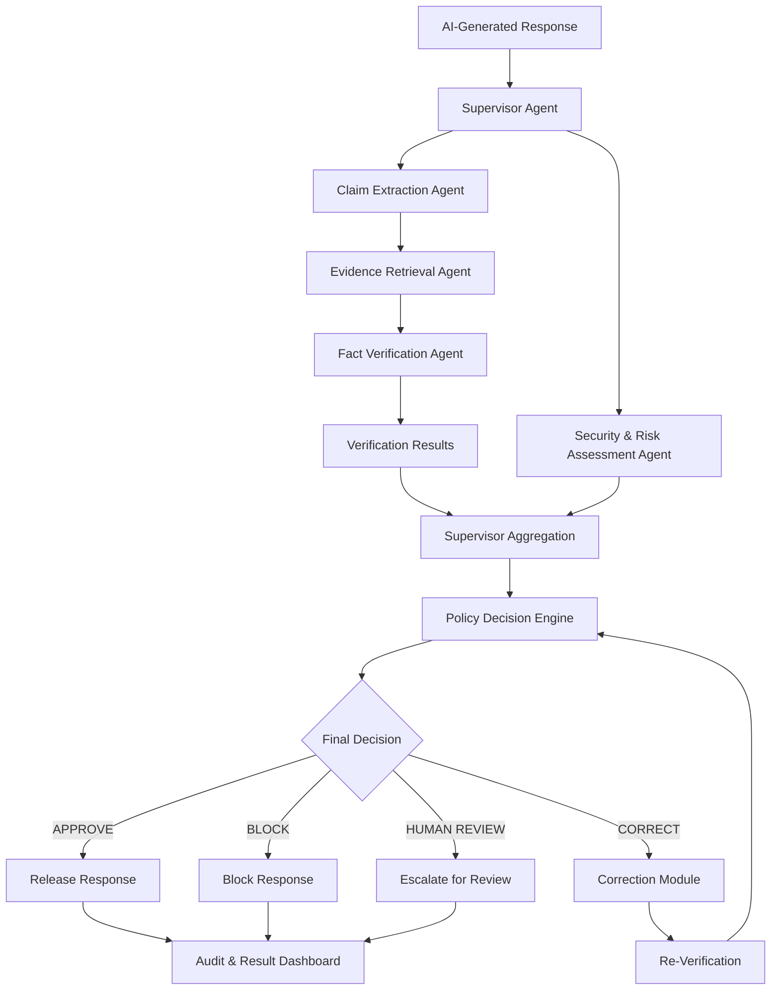

# AEGIS AI
### AI Evidence Guard for Integrity and Security

**An Intelligent Multi-Agent AI Verification and Security Framework**

<p align="center">
  <strong>Developed by Team LKNEX | SLIIT</strong>
</p>

<p align="center">
  
  
  
  
  
</p>

---

## 1. Overview

**AEGIS AI (AI Evidence Guard for Integrity and Security)** is a proposed intelligent verification and security framework designed to improve the reliability and safety of AI-generated responses.

As Large Language Models (LLMs) become increasingly integrated into applications and organisational workflows, concerns such as hallucinations, unsupported factual statements, indirect prompt injection and sensitive information exposure become increasingly important.

AEGIS AI addresses these challenges through a **hybrid supervisor-based multi-agent architecture** consisting of four specialised AI agents coordinated by a central Supervisor Agent and supported by a deterministic Policy Decision Engine.

The system analyses AI-generated responses, extracts factual claims, retrieves supporting evidence from trusted organisational documents, verifies factual consistency and assesses potential security threats before determining whether a response should be approved, corrected, blocked or escalated for human review.

### Our Vision

To establish an evidence-driven verification and security layer that helps organisations deploy AI systems with greater transparency, accountability and confidence.

---

## 2. Problem Statement

Despite the rapid development of generative AI technologies, deploying LLM-based applications in real-world environments introduces several challenges:

- **AI Hallucinations:** LLMs may generate inaccurate or fabricated information.
- **Unsupported Claims:** Generated responses may contain statements without sufficient supporting evidence.
- **Indirect Prompt Injection:** Malicious instructions embedded in external documents or retrieved content may influence AI behaviour.
- **Sensitive Information Exposure:** Responses may unintentionally disclose confidential or sensitive information.
- **Lack of Transparency:** Users may not have access to reliable evidence explaining why an AI-generated statement should be trusted.

Traditional retrieval-based approaches can provide relevant documents, but document retrieval alone does not guarantee that generated claims are factually supported or secure.

AEGIS AI aims to address these challenges by combining claim-level verification, evidence retrieval, security assessment and policy-based response enforcement within a unified architecture.

---

## 3. Proposed Solution

AEGIS AI introduces a multi-agent verification pipeline in which specialised agents collaborate to analyse AI-generated responses.

The system follows five major stages:

1. **Claim Extraction:** Identify individual factual claims within an AI-generated response.
2. **Evidence Retrieval:** Retrieve relevant information from authorised organisational documents.
3. **Fact Verification:** Compare extracted claims against retrieved evidence.
4. **Security Assessment:** Analyse generated responses and retrieved content for potential security threats.
5. **Policy Decision:** Determine the appropriate action based on verification results and security risk.

The final decision is generated through a deterministic policy engine rather than relying solely on an LLM-generated judgement.

---

## 4. System Architecture

AEGIS AI follows a **hybrid supervisor-based multi-agent architecture**.

The architecture consists of four specialised agents, a Supervisor Agent, a Knowledge Base, a Policy Decision Engine and a user-facing application.

### Architecture Components

| Component | Responsibility |
|---|---|
| Agent 01 – Claim Extraction | Extracts atomic factual claims from generated responses. |
| Agent 02 – Evidence Retrieval | Retrieves relevant evidence from trusted documents. |
| Agent 03 – Fact Verification | Evaluates claims against retrieved evidence. |
| Agent 04 – Security & Risk Assessment | Identifies potential prompt injection and information exposure risks. |
| Supervisor Agent | Coordinates agents, manages execution and aggregates results. |
| Policy Decision Engine | Applies deterministic rules to determine the final response action. |
| Correction Module | Generates evidence-based corrections and triggers re-verification. |

### Multi-Agent Workflow



---

## 5. Specialised AI Agents

### Agent 01 – Claim Extraction Agent

**Purpose:** Transform AI-generated responses into individually verifiable factual claims.

Key responsibilities:
- Extract atomic factual statements.
- Identify entities, dates and numerical values.
- Assign unique identifiers to extracted claims.
- Produce structured JSON outputs.

**Expected output:** A structured collection of factual claims.

### Agent 02 – Evidence Retrieval Agent

**Purpose:** Retrieve relevant and trustworthy evidence from authorised organisational documents.

Key responsibilities:
- Process uploaded PDF documents.
- Extract and clean document content.
- Divide documents into searchable chunks.
- Generate semantic embeddings.
- Perform vector-based and keyword-based retrieval.
- Preserve source references, page numbers and document metadata.

**Expected output:** Evidence passages linked to their corresponding claims.

### Agent 03 – Fact Verification Agent

**Purpose:** Determine whether extracted factual claims are supported by retrieved evidence.

Key responsibilities:
- Compare claims against retrieved evidence.
- Identify factual contradictions.
- Evaluate evidence sufficiency.
- Generate explanations for verification decisions.
- Maintain references to supporting evidence.

**Verification classifications:**

| Status | Description |
|---|---|
| SUPPORTED | Retrieved evidence supports the claim. |
| CONTRADICTED | Retrieved evidence conflicts with the claim. |
| INSUFFICIENT_EVIDENCE | Available evidence is insufficient to determine the claim's accuracy. |

### Agent 04 – Security & Risk Assessment Agent

**Purpose:** Analyse generated responses and retrieved content for potential security threats.

Key responsibilities:
- Detect suspicious instructions and prompt injection patterns.
- Inspect retrieved content for indirect prompt injection.
- Identify potential sensitive information exposure.
- Classify detected security risks.
- Generate structured security assessment results.

**Risk classifications:**

| Risk Level | Description |
|---|---|
| LOW | No significant threat identified by the assessment. |
| MEDIUM | Potential security concern requiring additional attention. |
| HIGH | Significant security threat requiring restrictive handling. |

*Security assessments are detection mechanisms, not guarantees that every attack will be identified.*

---

## 6. Supervisor Agent & Policy Decision Engine

### Supervisor Agent

The Supervisor Agent acts as the central orchestration component of AEGIS AI.

It is responsible for:
- Managing the execution of specialised agents.
- Maintaining shared workflow state.
- Coordinating sequential and parallel execution.
- Aggregating agent outputs.
- Handling execution failures and retries.
- Forwarding results to the Policy Decision Engine.

The orchestration layer is implemented using LangGraph.

### Policy Decision Engine

The Policy Decision Engine applies deterministic rules to the aggregated verification and security results.

It supports four possible decisions:

| Decision | Description |
|---|---|
| APPROVE | Release the response when the applicable verification and security requirements are satisfied. |
| CORRECT | Generate an evidence-based correction and re-verify it. |
| BLOCK | Prevent release when a critical security or policy condition is triggered. |
| HUMAN REVIEW | Escalate uncertain, conflicting or exceptional cases for human assessment. |

**Important:** The Policy Decision Engine is a rule-based backend component, not an additional AI agent. Security restrictions and access-control enforcement should remain deterministic.

---

## 7. Key Features

- Multi-agent AI verification architecture.
- Automated factual claim extraction.
- Evidence-based document retrieval.
- Claim-level factual verification.
- Security and prompt injection assessment.
- Sensitive information exposure checks.
- Deterministic policy-based response decisions.
- Evidence-based response correction.
- Correction re-verification.
- Source references and document traceability.
- Basic audit logging and verification history.
- Interactive verification dashboard.

---

## 8. Technology Stack

| Layer | Technologies |
|---|---|
| Frontend | React.js, Vite, Tailwind CSS |
| Backend | Python, FastAPI |
| Agent Orchestration | LangGraph |
| LLM Integration | LLM API provider |
| Embedding Model | Sentence Transformers |
| Vector Database | ChromaDB |
| Keyword Retrieval | BM25 |
| Document Processing | PyMuPDF |
| Data Validation | Pydantic |
| Audit Storage | SQLite |
| Version Control | Git, GitHub |

---

## 9. Project Structure

```text
AEGIS-AI/
│
├── backend/
│   ├── app/
│   │   ├── agents/
│   │   │   ├── claim_extraction.py
│   │   │   ├── evidence_retrieval.py
│   │   │   ├── fact_verification.py
│   │   │   └── security_assessment.py
│   │   │
│   │   ├── orchestration/
│   │   │   ├── supervisor.py
│   │   │   ├── state.py
│   │   │   └── workflow.py
│   │   │
│   │   ├── decision/
│   │   │   ├── policy_engine.py
│   │   │   └── correction.py
│   │   │
│   │   ├── knowledge_base/
│   │   │   ├── ingestion.py
│   │   │   ├── retrieval.py
│   │   │   └── vector_store.py
│   │   │
│   │   ├── schemas/
│   │   │   └── agent_schemas.py
│   │   │
│   │   └── main.py
│   │
│   ├── tests/
│   └── requirements.txt
│
├── frontend/
│   ├── public/
│   └── src/
│
├── data/
│   └── sample_documents/
│
├── docs/
│   ├── WORKFLOW.md
│   └── PROJECT_DETAILS.md
│
├── .env.example
├── .gitignore
└── README.md
```

---

## 10. Getting Started

Follow these instructions to set up the project locally.

### Prerequisites

Ensure that the following tools are installed:

- Python 3.10+
- Node.js and npm
- Git
- A supported LLM API key

### 1. Clone the Repository

```bash
git clone <YOUR_GITHUB_REPOSITORY_URL>
cd AEGIS-AI
```

### 2. Backend Setup

Navigate to the backend directory:

```bash
cd backend
```

Create a virtual environment:

```bash
python -m venv venv
```

Activate the virtual environment.

**Windows:**

```bash
venv\Scripts\activate
```

**Linux / macOS:**

```bash
source venv/bin/activate
```

Install dependencies:

```bash
pip install -r requirements.txt
```

Configure your environment variables using the project's `.env.example` file.

Create a `.env` file and provide the required API configuration.

Example:

```env
LLM_API_KEY=your_api_key_here
```

Start the FastAPI development server:

```bash
uvicorn app.main:app --reload
```

Backend API documentation will be available at:

```text
http://127.0.0.1:8000/docs
```

### 3. Frontend Setup

Open another terminal and navigate to the frontend directory:

```bash
cd frontend
```

Install dependencies:

```bash
npm install
```

Start the development server:

```bash
npm run dev
```

Open the local development URL displayed in your terminal.

---

## 11. Example Use Case

Consider an organisation that uses an AI assistant to answer employee policy questions.

**AI-generated response:**

> Employees must return all company equipment within 30 days after resignation.

**Trusted organisational document:**

> All company equipment must be returned within 14 days after resignation.

### Expected AEGIS AI Processing

| Stage | Expected Result |
|---|---|
| Claim Extraction | Extracts the claim about the 30-day return period. |
| Evidence Retrieval | Retrieves the relevant organisational policy stating 14 days. |
| Fact Verification | Identifies the claim as CONTRADICTED. |
| Security Assessment | Assesses the response for potential security threats. |
| Policy Decision | Selects CORRECT, assuming no blocking security condition exists. |
| Correction Module | Generates an evidence-based correction stating 14 days. |
| Re-Verification | Checks the corrected statement against the retrieved policy. |

**Expected final response:**

> Employees must return all company equipment within 14 days after resignation.

The corrected response can be presented with its supporting document reference.

---

## 12. Testing & Evaluation

AEGIS AI will be evaluated to assess the effectiveness of its verification and security capabilities.

### Evaluation Objectives

- Measure factual claim verification performance.
- Evaluate evidence retrieval quality.
- Assess security threat detection capabilities.
- Measure false positive and false negative rates.
- Evaluate response latency and API usage cost.
- Compare multi-agent and conventional verification approaches.

### Evaluation Metrics

| Category | Metrics |
|---|---|
| Factual Verification | Accuracy, Precision, Recall, F1-score |
| Evidence Retrieval | Precision@K, Recall@K |
| Security Assessment | Detection Rate, False Positive Rate |
| System Performance | Response Latency |
| Operational Cost | API Usage Cost |

### Baseline Comparison

The proposed framework can be evaluated against:

1. Unverified LLM-generated responses.
2. A single-agent verification approach.
3. The proposed four-agent AEGIS AI architecture.

The evaluation will investigate whether multi-agent coordination provides measurable improvements while considering additional latency and computational costs.

---

## 13. Development Roadmap

The MVP implementation is organised into eight development phases.

| Phase | Description | Status |
|---|---|---|
| Phase 01 | Project Setup & Architecture | In Progress |
| Phase 02 | Claim Extraction Agent | Planned |
| Phase 03 | Evidence Retrieval Agent | Planned |
| Phase 04 | Fact Verification Agent | Planned |
| Phase 05 | Security & Risk Assessment Agent | Planned |
| Phase 06 | Supervisor & Policy Decision Engine | Planned |
| Phase 07 | Backend API & Frontend Integration | Planned |
| Phase 08 | Testing, Evaluation & Finalisation | Planned |

---

## 14. Team

**Project Team: LKNEX**

**Institution:** Sri Lanka Institute of Information Technology (SLIIT)

A collaborative academic project focused on developing an evidence-driven AI verification and security framework.

---

## 15. Project Scope & Limitations

The initial implementation focuses on an MVP for verifying AI-generated responses against a controlled collection of trusted organisational documents.

Current scope includes:
- Text-based response verification.
- PDF-based organisational knowledge sources.
- Claim-level evidence matching.
- Security risk assessment.
- Policy-based response decisions.

The MVP does not claim to eliminate all AI hallucinations, guarantee complete security against prompt injection, or replace human security and compliance reviews.

---

## 16. Future Enhancements

Potential future development areas include:

- Integration with multiple LLM providers.
- Support for additional document formats.
- Advanced document version management.
- Role-based access control.
- More comprehensive security threat detection.
- Human feedback and review workflows.
- Advanced audit and reporting capabilities.
- Enterprise application integrations.
- Continuous monitoring and evaluation.

---

## 17. Contributors

Developed by **Team LKNEX**  
Sri Lanka Institute of Information Technology (SLIIT)

---

## 18. License

This project is currently developed for academic and research purposes.

A formal open-source license can be added when the project distribution and licensing terms are finalised.

---

<p align="center">
  <strong>AEGIS AI — Evidence Before Trust. Security Before Release.</strong>
</p>

<p align="center">
  Built with AI, Evidence, and Security in Mind.
</p>
